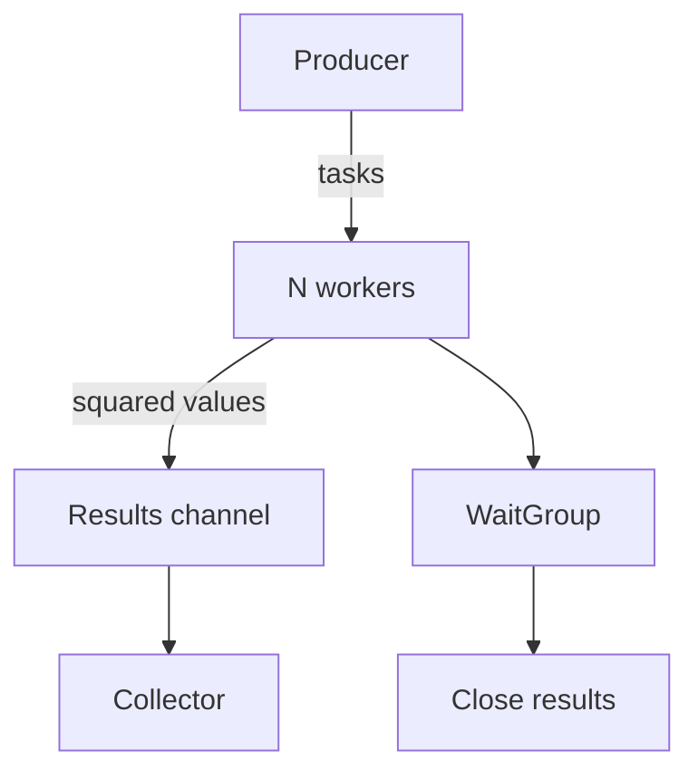

# Bounded Worker Pools

This exercise practices bounded concurrency, channel ownership, coordinated
shutdown, and context cancellation in Go.

## Concept

A worker pool limits the number of operations running concurrently. Instead of
starting one goroutine for every input, a fixed number of workers compete for
tasks from a shared channel.



The important ownership rules are:

- The producer is the only goroutine that closes the tasks channel.
- Workers receive tasks and send results; they do not close shared channels.
- A coordinator waits for every worker and then closes the results channel.
- The collector ranges over the results channel until it is closed.

Closing a channel means that no more values will be sent. It does not cancel a
blocked send, and it is unsafe to close a channel while another goroutine may
still send to it.

## Task 1: `WorkerPool`

Implement:

```go
func WorkerPool(inputs []int, workers int) []int
```

Requirements:

- Square every input exactly once.
- Use no more than `workers` worker goroutines.
- Treat `workers <= 0` as one worker.
- Avoid starting more workers than there are inputs.
- Return `nil` for empty input.
- Return all results, but do not preserve input order.
- Shut down all producer and worker goroutines before returning.
- Close each channel exactly once and only from its owning goroutine.

Because workers run concurrently, output order is intentionally
nondeterministic. Tests should compare results without depending on order.

## Task 2: `WorkerPoolWithTimeout`

Implement:

```go
func WorkerPoolWithTimeout(
    ctx context.Context,
    inputs []int,
    workers int,
) []int
```

It has the same behavior as `WorkerPool`, with these additional requirements:

- Stop scheduling new tasks when `ctx.Done()` is closed.
- Allow workers waiting for a task to observe cancellation.
- Allow workers blocked while sending a result to observe cancellation.
- Return the results delivered before the pipeline finishes shutting down.
- Return promptly for an already-cancelled context.
- Do not leak goroutines or send to a closed channel.

A range loop by itself is not cancellation-aware:

```go
for value := range tasks {
    // This goroutine cannot inspect ctx.Done() while waiting for a task.
}
```

Use `select` when an operation must wait for either channel activity or
cancellation. Receiving a task and sending its result are separate blocking
operations, so both need cancellation handling.

Cancellation can race with a channel operation. If a task or result and
`ctx.Done()` are ready simultaneously, `select` may choose either case. A value
already in flight may therefore appear in the returned partial results.

## Suggested implementation stages

1. Normalize the worker count.
2. Create the tasks and results channels.
3. Start the fixed set of workers and track them with `sync.WaitGroup`.
4. Start one producer that sends inputs and owns closing the tasks channel.
5. Start one coordinator that waits for workers and closes the results channel.
6. Collect results by ranging over the results channel.
7. Add cancellation to every potentially blocking operation in the cancellable
   version.

## Common mistakes

- Calling `WaitGroup.Add` inside the new goroutine.
- Closing the tasks channel from both producer and consumer.
- Closing the results channel before all workers have stopped sending.
- Using `break` inside `select` and expecting it to exit an enclosing loop.
- Checking `ctx.Done()` only after receiving from the tasks channel.
- Returning after cancellation without allowing internal goroutines to stop.
- Assuming concurrent results have deterministic ordering.

## Tests

Tests should cover:

- Empty input.
- One input and one worker.
- Multiple workers and unordered results.
- More workers than inputs.
- Zero or negative worker counts.
- Duplicate, zero, and negative values.
- Normal completion with a non-cancelled context.
- A context cancelled before the function starts.
- Cancellation while work is active.
- Prompt termination without double-close or send-on-closed-channel failures.

Run the normal suite and the race detector:

```bash
go test ./...
go test -race ./...
```

If using the repository Make target:

```bash
make 02_concurrency_03_bounded_worker_pools
```

## Further practice

- Return a struct containing the input, output, and worker ID.
- Preserve input order while retaining concurrent processing.
- Make the operation generic instead of always squaring integers.
- Compare unbuffered channels with small bounded buffers.
- Return cancellation causes or worker errors alongside partial results.
- Implement dynamic resizing and discuss when it is preferable to a fixed pool.
